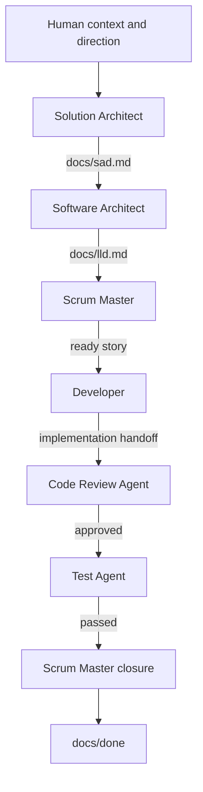

# Spec-Driven Delivery Agents

> [!IMPORTANT]
> This repository is a **copy-distribution package**, not an active spec-driven delivery project. Copy its packaged `.github/` customizations and `template/docs/` content into a consuming repository before using the agents. The absence of root-level `docs/sad.md`, `docs/lld.md`, `docs/todo/`, and `docs/done/` in this source repository is intentional; those paths are created in the consuming repository during installation. Do not invoke the packaged delivery workflow against this distribution repository itself.

A reusable set of GitHub Copilot custom agents for a specification-driven software delivery workflow.

The suite turns product intent into architecture, implementation design, traceable work items, production changes, independent code review, independent testing, and evidence-based closure. It deliberately separates responsibilities so that the same agent does not implement, approve, test, and close its own work.

The agents are project- and technology-agnostic. Their only predefined project interface is the `/docs` contract described below.

## Main Delivery (Happy) Pipeline



This diagram intentionally shows only the happy path. In the full workflow, two feedback loops are omitted for readability:

- If Code Review finds blocking issues, work returns to the Developer for correction before continuing.
- If Testing finds a production defect, work returns to the Developer for a fix and then goes through Code Review again when review is required.


## Greenfield Installation

Install from a versioned release or pinned commit of this repository. 

Use this procedure for a repository that does not already contain the destination files. For existing repositories, follow [Existing Repositories](#existing-repositories) instead so local instructions, agents, design documents, and work items are preserved.

1. Check out a versioned release or pinned commit of this repository.
2. Start from a clean working tree on a dedicated installation branch in the consuming repository.
3. Set `SUITE_ROOT` to the versioned checkout of this repository and copy the packaged files:

    ```sh
    SUITE_ROOT=/absolute/path/to/CBAE-spec-delivery-agents
    mkdir -p .github/agents docs/todo docs/done
    cp "$SUITE_ROOT/.github/copilot-instructions.md" .github/copilot-instructions.md
    cp "$SUITE_ROOT/.github/agents/solution-architect.agent.md" .github/agents/solution-architect.agent.md
    cp "$SUITE_ROOT/.github/agents/software-architect.agent.md" .github/agents/software-architect.agent.md
    cp "$SUITE_ROOT/.github/agents/scrum-master.agent.md" .github/agents/scrum-master.agent.md
    cp "$SUITE_ROOT/.github/agents/developer.agent.md" .github/agents/developer.agent.md
    cp "$SUITE_ROOT/.github/agents/code-review-agent.agent.md" .github/agents/code-review-agent.agent.md
    cp "$SUITE_ROOT/.github/agents/test-agent.agent.md" .github/agents/test-agent.agent.md
    cp "$SUITE_ROOT/template/docs/sad.md" docs/sad.md
    cp "$SUITE_ROOT/template/docs/lld.md" docs/lld.md
    touch docs/todo/.gitkeep docs/done/.gitkeep
    ```

4. Replace every SAD and LLD placeholder with verified project information. Keep both documents in `Draft` until the consuming project has approved them through its governance process.
5. Put project-specific architecture, implementation conventions, commands, paths, test locations, and technology decisions in `docs/sad.md` or `docs/lld.md`, not in the reusable agent files.
6. Record the installed release or commit in the consuming project's dependency or tooling documentation.
7. Reload VS Code or Copilot customizations if the agents do not appear immediately.

## Other installation cases

### Copy Exact Files and Destinations

Copy only the files listed below. Do not copy the source repository's entire `.github/` directory into an existing repository because that could overwrite unrelated workflows, issue templates, ownership rules, or local Copilot customizations.

| Source | Destination | Installation behavior |
|---|---|---|
| `.github/copilot-instructions.md` | `.github/copilot-instructions.md` | Copy when absent; otherwise merge as described below |
| `.github/agents/solution-architect.agent.md` | `.github/agents/solution-architect.agent.md` | Copy when absent; otherwise compare and merge deliberately |
| `.github/agents/software-architect.agent.md` | `.github/agents/software-architect.agent.md` | Copy when absent; otherwise compare and merge deliberately |
| `.github/agents/scrum-master.agent.md` | `.github/agents/scrum-master.agent.md` | Copy when absent; otherwise compare and merge deliberately |
| `.github/agents/developer.agent.md` | `.github/agents/developer.agent.md` | Copy when absent; otherwise compare and merge deliberately |
| `.github/agents/code-review-agent.agent.md` | `.github/agents/code-review-agent.agent.md` | Copy when absent; otherwise compare and merge deliberately |
| `.github/agents/test-agent.agent.md` | `.github/agents/test-agent.agent.md` | Copy when absent; otherwise compare and merge deliberately |
| `template/docs/sad.md` | `docs/sad.md` | Copy only when absent; never replace an established SAD |
| `template/docs/lld.md` | `docs/lld.md` | Copy only when absent; never replace an established LLD |
| `template/docs/todo/` | `docs/todo/` | Copy or create only when the destination directory is empty |
| `template/docs/done/` | `docs/done/` | Copy or create only when the destination directory is empty |

### Existing Repositories

For a repository with existing `.github/`, `docs/`, custom agents, or Copilot instructions:

1. Create a backup or checkpoint and perform the installation on a dedicated branch.
2. Inventory every destination in the table above and classify it as missing, identical, locally modified, or conflicting.
3. Copy missing agent files individually. Do not replace an existing file with the same name without reviewing both versions.
4. Merge the design-authority and separation-of-duties sections into an existing `.github/copilot-instructions.md`; preserve unrelated local instructions and resolve contradictory precedence explicitly.
5. Preserve existing `docs/sad.md` and `docs/lld.md`. Compare them with the templates and add only missing contract sections that are relevant to the project. Preserve established identifiers, approvals, decisions, terminology, and history.
6. Preserve all files under `docs/todo/` and `docs/done/`. Normalize legacy work items through the Scrum Master rather than replacing or moving them during installation.
7. Keep project-specific agent behavior in project documentation or clearly identified local additions. Do not silently weaken role boundaries, readiness gates, review independence, test independence, or closure ownership.
8. Verify the merged result before committing it.

### Conflict-Preserving Merge Behavior

Use a semantic merge rather than choosing all of either the source or target file:

- **Copilot instructions:** preserve all unrelated target guidance. Add the suite's design authority and role-separation rules once, reconcile precedence conflicts explicitly, and remove duplicate wording only after confirming that no constraint is lost.
- **Agent files:** preserve target-specific safety and project constraints while retaining the installed agent's role, tool restrictions, owned artifacts, readiness gates, transitions, and boundaries. If two agents must coexist, give them unique filenames and human-readable `name` values so users can distinguish them.
- **SAD and LLD:** treat the templates as structural checklists, not replacement files. Never overwrite approved requirements, identifiers, design decisions, or project history with placeholders.
- **Work items:** never overwrite, renumber, or bulk-move existing stories. Resolve schema differences through an explicit migration reviewed against the canonical story contract.
- **Other `.github/` content:** leave workflows, actions, issue templates, pull-request templates, ownership files, security configuration, and unrelated customizations untouched.

When a conflict cannot be resolved without changing product intent, architecture, or separation of duties, leave it visible and obtain the appropriate human or architect decision before completing installation.

## Contents

| File | Role |
|---|---|
| [.github/copilot-instructions.md](.github/copilot-instructions.md) | Always-loaded design authority and separation-of-duties rules |
| [.github/agents/solution-architect.agent.md](.github/agents/solution-architect.agent.md) | Product refinement and solution architecture |
| [.github/agents/software-architect.agent.md](.github/agents/software-architect.agent.md) | Low-level implementation design |
| [.github/agents/scrum-master.agent.md](.github/agents/scrum-master.agent.md) | Story creation, workflow coordination, and closure |
| [.github/agents/developer.agent.md](.github/agents/developer.agent.md) | Production implementation |
| [.github/agents/code-review-agent.agent.md](.github/agents/code-review-agent.agent.md) | Independent code review |
| [.github/agents/test-agent.agent.md](.github/agents/test-agent.agent.md) | Independent test creation, execution, and validation |
| [template/docs/sad.md](template/docs/sad.md) | Reusable Solution Architecture Document template |
| [template/docs/lld.md](template/docs/lld.md) | Reusable Low-Level Design template |

## Repository Layout

```text
.
├── README.md
├── .github/
│   ├── copilot-instructions.md
│   └── agents/
│       ├── solution-architect.agent.md
│       ├── software-architect.agent.md
│       ├── scrum-master.agent.md
│       ├── developer.agent.md
│       ├── code-review-agent.agent.md
│       └── test-agent.agent.md
└── template/
    └── docs/
        ├── sad.md
        ├── lld.md
        ├── todo/
        │   └── .gitkeep
        └── done/
            └── .gitkeep
```

The `.github/` directory mirrors the runtime location expected by GitHub Copilot. The `template/docs/` directory is copied into consuming projects to establish the project-facing contract without making the distribution repository itself look like an active delivery project.

## How to Use

Select the appropriate custom agent in GitHub Copilot Chat and give it a focused task.

### 1. Define or update the solution

Select **Solution Architect**.

Example request:

> Refine this product request, identify missing decisions, and update `docs/sad.md` with requirements, quality attributes, architecture, and traceability.

The Solution Architect may exercise delegated Product Owner authority within the supplied business frame and escalates decisions outside that authority.

### 2. Define implementation contracts

Select **Software Architect**.

Example request:

> Translate the approved SAD changes into implementation-ready contracts in `docs/lld.md`.

Do not proceed to story creation while material SAD requirements remain ambiguous or unallocated.

### 3. Create and activate stories

Select **Scrum Master**.

Example request:

> Decompose the approved SAD and LLD changes into traceable stories under `docs/todo/`.

After reviewing the generated backlog, ask the Scrum Master to activate a ready story. The Scrum Master owns the transition to the Developer.

### 4. Implement one story

Select **Developer** and provide the exact story path.

Example request:

> Implement `docs/todo/<id>-<slug>.md` according to its SAD and LLD references.

The Developer changes production only, records the Implementation Handoff, and transitions the story to its classified next stage.

### 5. Review the implementation

Select **Code Review Agent** and provide the same story path.

Example request:

> Independently review the implementation for `docs/todo/<id>-<slug>.md`.

The reviewer records `REV-###` findings. Blocking findings return to the Developer. Approval moves the story to testing or closure according to its classification.

### 6. Test the story

Select **Test Agent** and provide the story path after review approval.

Example request:

> Create and execute the required tests for `docs/todo/<id>-<slug>.md` and record validation evidence.

Production defects return to the Developer. When review is required, corrections pass through Code Review again before retesting.

### 7. Close the story

Select **Scrum Master**.

Example request:

> Verify Definition of Done and close `docs/todo/<id>-<slug>.md` if all evidence is complete.

Only the Scrum Master marks the story done and moves it to `docs/done/`.

## Design Principles

1. **Specifications are authoritative** — Product intent and architecture are documented before implementation.
2. **Traceability is preserved** — Requirements map to design decisions, stories, production changes, review evidence, and validation evidence.
3. **Roles are separated** — Production implementation, code review, testing, and closure have different owners.
4. **State is explicit** — Every story records its current stage, owner, review state, and testing state.
5. **Evidence controls completion** — A story is not done because an agent says it is done; required review and validation evidence must exist.
6. **Uncertainty is visible** — Facts, assumptions, decisions, blockers, and open questions are kept distinct.
7. **Project details live in `/docs`** — Agent definitions do not contain project names, technologies, source layouts, or local commands.

## Human and Agent Authority

Humans provide the initial business context, strategic direction, explicit constraints, and final authority.

The Solution Architect has bounded, delegated Product Owner authority. Within the human-provided frame, it may:

- Elicit and refine stakeholder needs and outcomes
- Define scope and non-goals
- Add, change, prioritize, defer, or remove requirements with rationale
- Resolve routine product trade-offs
- Approve requirements for downstream design
- Define measurable acceptance and quality criteria

It escalates decisions that change the product vision, contradict explicit human direction, interpret legal or organizational policy, create external commitments, set business risk tolerance, or lack enough evidence for a material or irreversible choice.

All other agents operate downstream from the approved solution specification.

## The `/docs` Contract

A consuming project provides these paths:

```text
docs/
├── sad.md
├── lld.md
├── todo/
└── done/
```

| Path | Contract |
|---|---|
| `docs/sad.md` | Solution Architecture Document: product intent, scope, requirements, constraints, quality attributes, system boundaries, integrations, decisions, risks, and traceability |
| `docs/lld.md` | Low-Level Design: implementation contracts, data structures, module boundaries, program flow, failure semantics, security, observability, migration, dependencies, conventions, and verification design |
| `docs/todo/` | Active work items and their canonical workflow state |
| `docs/done/` | Completed work items and retained delivery evidence |

The agents may inspect the workspace as evidence, but they do not assume any source directory, language, framework, build system, package manager, test framework, or deployment platform.

Starter versions are provided in [template/docs/sad.md](template/docs/sad.md) and [template/docs/lld.md](template/docs/lld.md). The tracked empty directories under `template/docs/todo/` and `template/docs/done/` preserve the complete contract when the template is copied.

### Document Ownership

| Artifact | Owner |
|---|---|
| `docs/sad.md` | Solution Architect |
| `docs/lld.md` | Software Architect |
| Story creation, activation, blocked coordination, and closure | Scrum Master |
| Production implementation handoff | Developer |
| Code Review evidence | Code Review Agent |
| Validation evidence | Test Agent |

## Traceability Identifiers

Existing project identifier schemes are preserved. If none exists, the suite uses:

| Prefix | Meaning | Owner |
|---|---|---|
| `FR-###` | Functional requirement | Solution Architect |
| `NFR-###` | Measurable quality attribute | Solution Architect |
| `CON-###` | Business, regulatory, operational, or technical constraint | Solution Architect |
| `DES-###` | Significant implementation-design decision | Software Architect |
| Sequential numeric story ID | Work item | Scrum Master |
| `REV-###` | Code Review finding | Code Review Agent |

Identifiers are stable. Existing IDs are not renumbered, and removed requirements are deprecated rather than silently deleted.

## Separation of Duties

| Role | May change | Must not change |
|---|---|---|
| Solution Architect | Solution architecture documentation | Application implementation or low-level design |
| Software Architect | Low-level design documentation | Product intent or application implementation |
| Scrum Master | Work-item files and workflow state | Architecture, production code, or tests |
| Developer | Production implementation and implementation handoff | Tests, review findings, validation evidence, or story closure |
| Code Review Agent | Review evidence and review state | Production code, tests, acceptance evidence, or story closure |
| Test Agent | Test assets and validation evidence | Production implementation, architecture, review findings, or story closure |

## Canonical Story Contract

The Scrum Master creates one Markdown file per work item at `docs/todo/<id>-<slug>.md`.

```markdown
---
id: <sequential number>
title: <short outcome-oriented title>
status: new | active | done
workflow_stage: planned | implementation | review | testing | closure | blocked | done
current_owner: scrum-master | developer | code-review-agent | test-agent
component: <component from docs/sad.md>
priority: critical | high | medium | low
depends_on: [<work-item IDs>]
requirements: [<FR/NFR/CON or established IDs>]
design_refs: [<docs/lld.md section or DES IDs>]
review: required | not-required
review_state: pending | approved | changes-required | not-required
testing: required | not-required
testing_state: pending | passed | failed | blocked | not-required
---

## Description
<outcome, reason, and delivery boundary>

## Out of Scope
<explicitly excluded adjacent behavior>

## Acceptance Criteria
- [ ] <observable, objectively verifiable behavior>
- [ ] <relevant failure or boundary behavior>

## Implementation Handoff
<changed production files, intended criteria coverage, risks, and deviations>

## Code Review
- [ ] <independent review approval and finding status, or exemption rationale>

## Validation
- [ ] <test, inspection, metric, or demonstration and its evidence>

## Blockers
<originating stage, responsible role, issue, impact, and resolution evidence; None when clear>

## Notes
<decisions, blockers, assumptions, and concise implementation considerations from the LLD>
```

### Initial State

New stories begin with:

```yaml
status: new
workflow_stage: planned
current_owner: scrum-master
```

Required gates begin as `pending`. Exempt gates begin as `not-required`, with rationale in the corresponding story section.

## Workflow State Machine

| From | Actor | To |
|---|---|---|
| `planned` | Scrum Master | `implementation`, owner `developer` |
| `implementation` | Developer | `review`, owner `code-review-agent`, when review is required |
| `implementation` | Developer | `testing`, owner `test-agent`, only when review is explicitly exempt and testing is required |
| `implementation` | Developer | `closure`, owner `scrum-master`, only when review and testing are explicitly exempt |
| `review` | Code Review Agent | `implementation`, owner `developer`, when changes are required |
| `review` | Code Review Agent | `testing`, owner `test-agent`, when approved and testing is required |
| `review` | Code Review Agent | `closure`, owner `scrum-master`, when approved and testing is exempt |
| `testing` | Test Agent | `implementation`, owner `developer`, for a production defect |
| `testing` | Test Agent | `closure`, owner `scrum-master`, when validation passes |
| Any active stage | Current role | `blocked`, owner `scrum-master`, when coordinated resolution is required |
| `blocked` | Scrum Master | Appropriate previous or next stage after resolution evidence is recorded |
| `closure` | Scrum Master | `done`, followed by movement to `docs/done/` |

Only the Scrum Master activates a planned story, routes a resolved blocked story, and closes a completed story.

## Review and Testing Classifications

### Review

Use `review: required` for changes to production code, production configuration, migrations, runtime dependencies, deployment behavior, or executable operational behavior.

Use `review: not-required` only when no production implementation is changed. Record the rationale in the Code Review section.

Review may not be exempted merely to bypass review findings.

### Testing

Use `testing: required` for executable behavior, defect fixes, interfaces, persistence, security behavior, migrations, or operational behavior.

Use `testing: not-required` only when verification does not involve exercising product behavior. Record both the rationale and alternative evidence.

Testing may not be exempted because tests are failing, unavailable, expensive, or inconvenient.

## Blocked Work

Any active role may identify a blocker, but blocked workflow coordination belongs to the Scrum Master.

The detecting agent records:

- Originating stage
- Responsible role
- Issue
- Impact
- Evidence needed for resolution

It then sets:

```yaml
workflow_stage: blocked
current_owner: scrum-master
```

After resolution evidence is recorded, the Scrum Master restores the appropriate stage and owner. When returning to review or testing, the corresponding gate state is reset to `pending`.

## Definitions of Ready and Done

### Ready

Before activation, a story must have:

- Resolvable requirement and design references
- Clear outcome and scope boundary
- Objective acceptance criteria
- Known dependencies and assumptions
- Approved priority and acceptance intent
- Explicit review and testing classifications
- Meaningful validation plan
- No unresolved design decision delegated to the implementer

The Scrum Master then sets the story to `active` and assigns the implementation stage to the Developer.

### Done

Before closure, a story must have:

- Completed acceptance, Code Review, and validation checkboxes
- `workflow_stage: closure`
- `current_owner: scrum-master`
- Approved Code Review with no blocking findings, or a valid exemption
- Passed independent testing, or a valid exemption with alternative evidence
- Updated documentation and traceability
- No unresolved blocker
- Recorded deviations and residual risks

The Scrum Master sets the story to `done` and moves it to `docs/done/`.


## Existing Projects and Legacy Stories

Existing SAD and LLD documents can be adopted without rewriting them wholesale. Preserve established identifiers and conventions when they are coherent.

Legacy work items that do not contain the canonical workflow fields must be normalized by the Scrum Master before Developer, Code Review, or Test agents process them. Downstream agents intentionally reject missing or invalid workflow metadata.

## Extending the Suite

When adding or changing an agent:

1. Keep one clear role per agent.
2. Give the agent only the tools required by that role.
3. Preserve the `/docs` contract and project neutrality.
4. Update every producer and consumer of changed story fields.
5. Update the state-transition table and this README.
6. Preserve independent implementation, review, testing, and closure.
7. Validate exemption paths, rejection loops, blocked transitions, and Definition of Done.

Project-specific behavior belongs in the consuming project's SAD, LLD, active stories, or local instructions—not in the reusable agent suite.

## Non-Goals

This suite does not:

- Replace final human authority
- Define a project's technology stack or source layout
- Commit, merge, publish, or deploy by default
- Modify remote systems by default
- Allow one role to implement, approve, test, and close its own work
- Treat passing tests as proof that undocumented requirements are satisfied

## License

MIT License

Copyright (c) 2026

Permission is hereby granted, free of charge, to any person obtaining a copy
of this software and associated documentation files (the "Software"), to deal
in the Software without restriction, including without limitation the rights
to use, copy, modify, merge, publish, distribute, sublicense, and/or sell
copies of the Software, and to permit persons to whom the Software is
furnished to do so, subject to the following conditions:

The above copyright notice and this permission notice shall be included in all
copies or substantial portions of the Software.

THE SOFTWARE IS PROVIDED "AS IS", WITHOUT WARRANTY OF ANY KIND, EXPRESS OR
IMPLIED, INCLUDING BUT NOT LIMITED TO THE WARRANTIES OF MERCHANTABILITY,
FITNESS FOR A PARTICULAR PURPOSE AND NONINFRINGEMENT. IN NO EVENT SHALL THE
AUTHORS OR COPYRIGHT HOLDERS BE LIABLE FOR ANY CLAIM, DAMAGES OR OTHER
LIABILITY, WHETHER IN AN ACTION OF CONTRACT, TORT OR OTHERWISE, ARISING FROM,
OUT OF OR IN CONNECTION WITH THE SOFTWARE OR THE USE OR OTHER DEALINGS IN THE
SOFTWARE.
