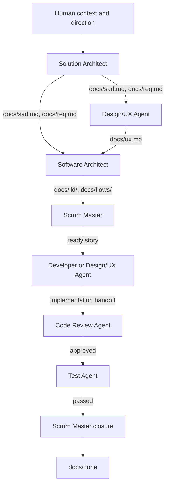

# Spec-Driven Delivery Agents

> [!IMPORTANT]
> This repository is a **copy-distribution package**, not an active spec-driven delivery project. Install its agents and skills into a consuming repository before using them: `.claude/` for Claude Code, `.github/` for GitHub Copilot. The absence of a root-level `docs/` folder and of an instruction file here is intentional: the installer creates them in the consuming repository. Do not run the packaged delivery workflow against this distribution repository itself.

A reusable set of agents and skills for a specification-driven software delivery workflow, packaged for **Claude Code** and for **GitHub Copilot**.

The suite turns product intent into architecture, interface design, implementation design, traceable work items, production changes, independent code review, independent testing, and evidence-based closure. It deliberately separates responsibilities so that the same agent does not implement, approve, test, and close its own work.

The agents are project- and technology-agnostic. Their only predefined project interface is the `docs/` contract described below. Everything a project knows about itself lives in that contract and in the project's own domain skills.

## Main Delivery (Happy) Pipeline



This diagram shows only the happy path. Two feedback loops are omitted for readability:

- If Code Review finds blocking issues, work returns to the implementing role for correction before continuing.
- If Testing finds a production defect, work returns to the implementing role for a fix and then goes through Code Review again when review is required.

The Design/UX Agent has two jobs: it owns the UX specification, and it implements frontend stories. A product with no user interface runs without it.

## What the Suite Is Built Around

1. **Registers, not monoliths.** The specification is split into small registers with stable IDs: requirements, questions, facts, decisions, bugs, and one LLD file per section. An agent reads the items a story cites, not whole documents. This is what keeps token use low as a project grows.
2. **Design documents describe the present.** The SAD, the requirements, the UX specification, the LLD and the flows say what the design is. What changed, when and who decided goes to one change log.
3. **Tooling instead of repeated rules.** Three skills carry the rules and the scripts, so the agent files stay short: `spec-lookup` prints items by ID, `spec-authoring` defines the formats and lints the set, `spec-bootstrap` creates the set in an empty repository.
4. **Project knowledge in domain skills.** Rules that several roles must apply, such as a data store's modelling rules or a design system's wiring, are written once as a project skill with a per-role table. The agent files never carry them.

## Installation

Requirements: Claude Code or GitHub Copilot, and `bash` with the standard Unix tools (`grep`, `awk`, `sed`, `find`, `sort`, `comm`). On Windows use WSL or Git Bash.

Install from a versioned release or pinned commit of this repository, on a dedicated branch of the consuming repository.

```sh
/absolute/path/to/spec-driven-dev-agents/install.sh /absolute/path/to/your-repository --claude
/absolute/path/to/spec-driven-dev-agents/install.sh /absolute/path/to/your-repository --copilot
```

The installer copies the agents and skills of the chosen variant, then runs `init-spec.sh` in the target, which creates the `docs/` skeleton and the instruction file and finishes with a clean specification check.

| Option | Effect |
|---|---|
| `--claude` | Install `.claude/agents/` and `.claude/skills/`; the instruction file is `CLAUDE.md` |
| `--copilot` | Install `.github/agents/` and `.github/skills/`; the instruction file is `.github/copilot-instructions.md` |
| `--no-ux` | Skip `docs/ux.md`, for a product with no user interface |
| `--dry-run` | List what would be copied and created, change nothing |

One of the two variant flags is required; both together install both variants, which share one `docs/` set. The installer is **copy-when-absent**. It never overwrites a file. A file that exists and differs from the packaged version is listed, so it can be compared and merged by hand. An existing instruction file is left unchanged and the installer names the template to merge from. Only the agents and skills folders are copied: workflows, issue templates and everything else under the target's `.github/` or `.claude/` stay untouched. Running the installer again is safe.

Manual installation is the same three steps: copy the variant's `agents/` and `skills/` folders, run its `skills/spec-bootstrap/scripts/init-spec.sh`, and record the installed release or commit in the consuming project's tooling documentation.

### Existing Repositories

1. Create a checkpoint and install on a dedicated branch.
2. Run the installer with `--dry-run` first and read the list.
3. Merge each file the installer reports as differing. Preserve project-specific safety and constraints while keeping the installed agent's role, tool restrictions, owned artifacts, readiness gates, transitions and boundaries.
4. Merge the template's sections into an existing `CLAUDE.md` or `.github/copilot-instructions.md`; keep unrelated local instructions and resolve contradictory precedence explicitly.
5. Never overwrite approved requirements, identifiers, design decisions or stories with a skeleton. Existing IDs are preserved; a project with its own coherent ID scheme keeps it and adds its families to the two scripts.
6. Leave everything else under `.claude/` and `.github/` untouched.

### Upgrading from the Single-File Layout

Earlier versions of this suite kept everything in `docs/sad.md` and `docs/lld.md`. To move such a project to the registers:

1. Install as above. The installer leaves the existing `docs/sad.md` in place and creates the missing registers.
2. Ask the Solution Architect to move the FR and NFR items to `docs/req.md`, the open questions to `docs/questions.md`, and the decisions to `docs/decision_log.md`, keeping every ID, and to move revision notes and dated amendments to `docs/change_log.md`.
3. Ask the Software Architect to split `docs/lld.md` into `docs/lld/`, one file per section, with the design decisions as rows in `14-design-decisions.md`, then delete `docs/lld.md`.
4. Run `spec-check.sh` until it is clean. It reports every ID that lost its definition and every design document that still carries history.

## Repository Layout

```text
.
├── README.md
├── LICENSE
├── install.sh                 installer for either variant
├── sync-github.sh             rebuilds .github/ from .claude/
├── .claude/                   Claude Code variant (the source)
│   ├── agents/
│   │   ├── solution-architect.agent.md
│   │   ├── design-ux-agent.agent.md
│   │   ├── software-architect.agent.md
│   │   ├── scrum-master.agent.md
│   │   ├── developer.agent.md
│   │   ├── code-review-agent.agent.md
│   │   └── test-agent.agent.md
│   └── skills/
│       ├── spec-lookup/
│       │   ├── SKILL.md
│       │   └── scripts/spec.sh
│       ├── spec-authoring/
│       │   ├── SKILL.md
│       │   ├── scripts/next-id.sh
│       │   ├── scripts/spec-check.sh
│       │   └── guards/test_spec_registers.py
│       └── spec-bootstrap/
│           ├── SKILL.md
│           ├── scripts/init-spec.sh
│           └── templates/
│               ├── CLAUDE.md
│               ├── docs/                  (the skeleton of every register)
│               └── domain-skill/SKILL.template.md
└── .github/                   GitHub Copilot variant (generated)
    ├── agents/                the same seven agents
    └── skills/                the same three skills; the template is copilot-instructions.md
```

Each folder mirrors the runtime location its tool expects. The skeletons live inside the `spec-bootstrap` skill, so a consuming repository carries them and can create a missing register later without this distribution repository.

### Two Variants, One Source

`.claude/` is the source. `.github/` is generated from it by `sync-github.sh` and is never edited by hand.

| | Claude Code (`.claude/`) | GitHub Copilot (`.github/`) |
|---|---|---|
| Agent files | `.claude/agents/<role>.agent.md` | `.github/agents/<role>.agent.md` |
| Frontmatter `tools` | `Read, Glob, Grep, Edit, Write`, plus `Bash`, plus `WebFetch, WebSearch` | `read, edit, search`, plus `execute`, plus `web` |
| Frontmatter `model`, `effort` | Set per role | Omitted; the model is chosen in the chat |
| Skills | `.claude/skills/<skill>/` | `.github/skills/<skill>/` |
| Always-loaded instructions | `CLAUDE.md` | `.github/copilot-instructions.md` |
| Agent body, skill text, skeletons | Identical, except that folder paths and the instruction-file name follow the variant | |
| Scripts and the pytest guard | Byte-identical; they locate their own folder at run time | |

```sh
./sync-github.sh           # rebuild .github/ after changing anything under .claude/
./sync-github.sh --check   # fail when .github/ is out of date, for CI
```

The generator stops when it meets a tool name it cannot map or when a Claude Code path survives the rewrite.

| File | Role |
|---|---|
| [install.sh](install.sh) | Copy-when-absent installer for either variant |
| [sync-github.sh](sync-github.sh) | Generates the Copilot variant from the Claude Code variant |
| [solution-architect.agent.md](.claude/agents/solution-architect.agent.md) | Product refinement and solution architecture |
| [design-ux-agent.agent.md](.claude/agents/design-ux-agent.agent.md) | UX specification and frontend implementation |
| [software-architect.agent.md](.claude/agents/software-architect.agent.md) | Low-level implementation design and flows |
| [scrum-master.agent.md](.claude/agents/scrum-master.agent.md) | Story creation, workflow coordination and closure |
| [developer.agent.md](.claude/agents/developer.agent.md) | Production implementation |
| [code-review-agent.agent.md](.claude/agents/code-review-agent.agent.md) | Independent code review |
| [test-agent.agent.md](.claude/agents/test-agent.agent.md) | Independent test creation, execution and validation |
| [spec-lookup](.claude/skills/spec-lookup/SKILL.md) | Read specification items by ID |
| [spec-authoring](.claude/skills/spec-authoring/SKILL.md) | Item formats, ID rules, ownership, and the specification check |
| [spec-bootstrap](.claude/skills/spec-bootstrap/SKILL.md) | Skeletons, the init script, the section layout and the first-run order |

## The `docs/` Contract

A consuming project provides these paths. `init-spec.sh` creates all of them.

```text
docs/
├── sad.md              architecture, scope, constraints, risks
├── req.md              requirements
├── ux.md               UX specification                      (optional)
├── questions.md        open questions and clarifications
├── facts.md            observed facts                        (optional)
├── decision_log.md     architectural decisions
├── bugs.md             bug register                          (optional)
├── change_log.md       history of every specification change
├── lld/                low-level design, one file per section
│   ├── README.md       index
│   ├── 01 … 04, 06 … 16   cross-cutting sections
│   └── 5.NN-<slug>.md  one interface area per file
├── flows/              Mermaid data flows and workflows      (optional)
├── todo/               active work items, by epic and feature
└── done/               completed work items
```

| Path | Contract | Owner |
|---|---|---|
| `docs/sad.md` | Context, stakeholders, scope, constraints, assumptions, architecture, integrations, security, risks and technical debt | Solution Architect |
| `docs/req.md` | Functional requirements and quality attributes, each with `Design:` and `Verification:` lines | Solution Architect |
| `docs/questions.md` | Open questions and cross-document clarifications, each with a status and the decision | Solution Architect, Design/UX Agent |
| `docs/facts.md` | Verified facts about the real data and environment | Solution Architect |
| `docs/decision_log.md` | Architectural decisions in ADR form | Solution Architect |
| `docs/ux.md` | Design direction, information architecture, every surface, data needs per view | Design/UX Agent |
| `docs/lld/` | Implementation contracts: boundaries, data, interfaces, flow, failures, security, configuration, observability, migration, verification, conventions, and the design-decision register | Software Architect |
| `docs/flows/` | One file per user action: an overview diagram and a detailed sequence | Software Architect |
| `docs/bugs.md` | Bug register with status and the story of each bug | Scrum Master |
| `docs/todo/`, `docs/done/` | Work items and their canonical workflow state; completed items and their evidence | Scrum Master |
| `docs/change_log.md` | One entry per change to a design document or register | Everyone appends |

The agents may inspect the workspace as evidence, but they do not assume any source directory, language, framework, build system, package manager, test framework or deployment platform.

## Traceability Identifiers

An item is defined exactly once, in the file of its family, and cited by ID everywhere else. Identifiers are stable: they are never renumbered or reused, and an item that no longer applies keeps its ID with a status that says so.

| Prefix | Meaning | Defined in | Owner |
|---|---|---|---|
| `FR-###` | Functional requirement | `docs/req.md` | Solution Architect |
| `NFR-###` | Measurable quality attribute | `docs/req.md` | Solution Architect |
| `G-#`, `NG-#`, `BL-#` | Goal, non-goal, backlog item | `docs/sad.md` | Solution Architect |
| `CON-###`, `A-#` | Constraint, assumption | `docs/sad.md` | Solution Architect |
| `DEBT-#` | Technical debt | `docs/sad.md` | Solution Architect |
| `OQ-#` | Open question | `docs/questions.md` | Solution Architect |
| `FACT-#` | Observed fact | `docs/facts.md` | Solution Architect |
| `AD-##` | Architectural decision | `docs/decision_log.md` | Solution Architect |
| `UX-<area>#` | Interface element | `docs/ux.md` | Design/UX Agent |
| `D-##` | Data need of a view | `docs/ux.md` | Design/UX Agent |
| `C-#` | Cross-document clarification | `docs/questions.md` | Design/UX Agent |
| `DES-###` | Implementation-design decision | `docs/lld/14-design-decisions.md` | Software Architect |
| `BUG-###` | Bug | `docs/bugs.md` | Scrum Master |
| Sequential numeric story ID | Work item | `docs/todo/` | Scrum Master |
| `REV-###` | Code Review finding | The story | Code Review Agent |

## Skills and Scripts

```sh
.claude/skills/spec-lookup/scripts/spec.sh FR-042 DES-103     # print the definition of each ID
.claude/skills/spec-lookup/scripts/spec.sh --refs FR-042      # every citation, for impact analysis
.claude/skills/spec-lookup/scripts/spec.sh --lld 5.03         # one LLD section file
.claude/skills/spec-authoring/scripts/next-id.sh FR           # the next free ID of a family
.claude/skills/spec-authoring/scripts/spec-check.sh           # lint the specification set
.claude/skills/spec-bootstrap/scripts/init-spec.sh            # create whatever is missing
```

`spec-check.sh` exits 0 when clean and 1 with findings. It reports missing core files, an ID defined twice or outside its register, a citation with no definition, history text in a design document, and a register item without a `Status:` line. Call it from any test runner or CI step. A pytest wrapper is included at `.claude/skills/spec-authoring/guards/test_spec_registers.py`; copy it into the project's test folder.

The commands above show the Claude Code paths; in the Copilot variant the same scripts are under `.github/skills/`. The two architect agents have no shell by design. The orchestrator runs `spec-check.sh` after an agent has changed a file under `docs/`, and the instruction file says so.

## Domain Skills

Put project knowledge that several roles must apply into a skill of its own under `.claude/skills/` or `.github/skills/`, not into the agent files. Every agent has the same instruction: load the applicable domain skill before deciding, designing, implementing, reviewing or testing in its area, and apply the sections addressed to its role.

Start from `skills/spec-bootstrap/templates/domain-skill/SKILL.template.md`. A domain skill has:

- a description that says when to load it;
- a table with one row per role: when that role loads the skill and what it owes;
- short numbered sections, each checkable;
- a review checklist the Code Review Agent runs in full;
- a last section naming the files the rules apply to.

A conflict between a domain skill and a requirement, contract or story is specification drift. It is reported to the owning role and never resolved silently.

Typical domain skills: the modelling and query rules of the project's data store, and the frontend design system as wired in code. The Design/UX Agent also loads a visual-language skill and an output-quality skill when the workspace carries them; the suite ships none, because they are a matter of taste and of third-party licence.

## How to Use

Start the role's agent in Claude Code, or select it in GitHub Copilot Chat, and give it a focused task. Whoever routes the work, the main chat session or the person selecting the agents, is the orchestrator: the orchestrator runs the specification check and does not do a role's work itself.

| Step | Agent | Example request |
|---|---|---|
| 1. Define or update the solution | Solution Architect | "Refine this product request, identify missing decisions, and update the SAD and the requirements." |
| 2. Specify the interface | Design/UX Agent | "Specify the screens for the approved requirements in `docs/ux.md`." |
| 3. Define implementation contracts | Software Architect | "Translate the approved requirements into implementation-ready contracts in `docs/lld/` and draw the flows." |
| 4. Create and activate stories | Scrum Master | "Decompose the approved changes into traceable stories under `docs/todo/`, then activate the first ready story." |
| 5. Implement one story | Developer, or Design/UX Agent for a frontend story | "Implement `docs/todo/<epic>/<feature>/<id>-<slug>.md`." |
| 6. Review the implementation | Code Review Agent | "Independently review the implementation for that story." |
| 7. Test the story | Test Agent | "Create and run the tests for that story and record validation evidence." |
| 8. Close the story | Scrum Master | "Verify Definition of Done and close the story if all evidence is complete." |

Do not proceed to story creation while a requirement the stories depend on is behind an open question. The Test Agent tests at MVP level by default: the happy path of each acceptance criterion and the critical stoppers. Deeper coverage is a story-level decision.

## Separation of Duties

| Role | May change | Must not change |
|---|---|---|
| Solution Architect | The SAD, requirements, open questions, facts and the decision log | Application implementation, the UX specification or the low-level design |
| Design/UX Agent | The UX specification and clarifications; frontend implementation of its story | Requirements, the low-level design, tests, review findings or story closure |
| Software Architect | The low-level design and the flows | Product intent or application implementation |
| Scrum Master | Work-item files, workflow state and the bug register | Architecture, production code or tests |
| Developer | Production implementation and its implementation handoff | Tests, review findings, validation evidence or story closure |
| Code Review Agent | Review evidence and review state | Production code, tests, acceptance evidence or story closure |
| Test Agent | Test assets and validation evidence | Production implementation, architecture, review findings or story closure |

## Canonical Story Contract

The Scrum Master creates one Markdown file per work item at `docs/todo/<epic>/<feature>/<id>-<slug>.md`. Bug stories live in `docs/todo/bugs/`. A completed story moves, flat, to `docs/done/<id>-<slug>.md`. Every epic folder has a `README.md` listing its features and stories in priority order, and `docs/todo/README.md` lists the epics. Story IDs are one sequence across all epics.

```markdown
---
id: <sequential number>
title: <short outcome-oriented title>
status: new | active | done
workflow_stage: planned | implementation | review | testing | closure | blocked | done
current_owner: scrum-master | developer | design-ux-agent | code-review-agent | test-agent
component: <component from docs/sad.md>
priority: critical | high | medium | low
depends_on: [<work-item IDs>]
requirements: [<FR/NFR/CON or established IDs>]
design_refs: [<LLD section numbers such as "LLD 5.03", DES IDs, UX-/D- IDs>]
review: required | not-required
review_state: pending | approved | changes-required | not-required
testing: required | not-required
testing_state: pending | passed | failed | blocked | not-required
---

## Description
<outcome, reason, and delivery boundary>

## Out of Scope
<explicitly excluded adjacent behavior>

## Acceptance Criteria
- [ ] <observable, objectively verifiable behavior>
- [ ] <relevant failure or boundary behavior>

## Implementation Handoff
<changed production files, intended criteria coverage, risks, and deviations>

## Code Review
- [ ] <independent review approval and finding status, or exemption rationale>

## Validation
- [ ] <test, inspection, metric, or demonstration and its evidence>

## Blockers
<originating stage, responsible role, issue, impact, and resolution evidence; None when clear>

## Notes
<decisions, blockers, assumptions, and concise implementation considerations from the LLD>
```

### Initial State

New stories begin with:

```yaml
status: new
workflow_stage: planned
current_owner: scrum-master
```

Required gates begin as `pending`. Exempt gates begin as `not-required`, with rationale in the corresponding story section.

## Workflow State Machine

| From | Actor | To |
|---|---|---|
| `planned` | Scrum Master | `implementation`, owner `developer`, or `design-ux-agent` for a frontend story |
| `implementation` | Implementing role | `review`, owner `code-review-agent`, when review is required |
| `implementation` | Implementing role | `testing`, owner `test-agent`, only when review is explicitly exempt and testing is required |
| `implementation` | Implementing role | `closure`, owner `scrum-master`, only when review and testing are explicitly exempt |
| `review` | Code Review Agent | `implementation`, owner the implementing role, when changes are required |
| `review` | Code Review Agent | `testing`, owner `test-agent`, when approved and testing is required |
| `review` | Code Review Agent | `closure`, owner `scrum-master`, when approved and testing is exempt |
| `testing` | Test Agent | `implementation`, owner the implementing role, for a production defect |
| `testing` | Test Agent | `closure`, owner `scrum-master`, when validation passes |
| Any active stage | Current role | `blocked`, owner `scrum-master`, when coordinated resolution is required |
| `blocked` | Scrum Master | Appropriate previous or next stage after resolution evidence is recorded |
| `closure` | Scrum Master | `done`, followed by movement to `docs/done/` |

The implementing role is the Developer, or the Design/UX Agent for a frontend story. Only the Scrum Master activates a planned story, routes a resolved blocked story, and closes a completed story.

## Review and Testing Classifications

### Review

Use `review: required` for changes to production code, production configuration, migrations, runtime dependencies, deployment behavior, or executable operational behavior.

Use `review: not-required` only when no production implementation is changed. Record the rationale in the Code Review section.

Review may not be exempted merely to bypass review findings.

### Testing

Use `testing: required` for executable behavior, defect fixes, interfaces, persistence, security behavior, migrations, or operational behavior.

Use `testing: not-required` only when verification does not involve exercising product behavior. Record both the rationale and alternative evidence.

Testing may not be exempted because tests are failing, unavailable, expensive, or inconvenient.

## Blocked Work

Any active role may identify a blocker, but blocked workflow coordination belongs to the Scrum Master.

The detecting agent records:

- Originating stage
- Responsible role
- Issue
- Impact
- Evidence needed for resolution

It then sets:

```yaml
workflow_stage: blocked
current_owner: scrum-master
```

After resolution evidence is recorded, the Scrum Master restores the appropriate stage and owner. When returning to review or testing, the corresponding gate state is reset to `pending`.

## Definitions of Ready and Done

### Ready

Before activation, a story must have:

- Resolvable requirement and design references, none behind an open question
- Clear outcome and scope boundary
- Objective acceptance criteria
- Known dependencies and assumptions
- Approved priority and acceptance intent
- Explicit review and testing classifications
- Meaningful validation plan
- No unresolved design decision delegated to the implementer

The Scrum Master then sets the story to `active` and assigns the implementation stage to the Developer, or to the Design/UX Agent for a frontend story.

### Done

Before closure, a story must have:

- Completed acceptance, Code Review, and validation checkboxes
- `workflow_stage: closure`
- `current_owner: scrum-master`
- Approved Code Review with no blocking findings, or a valid exemption
- Passed independent testing, or a valid exemption with alternative evidence
- Updated documentation and traceability
- No unresolved blocker
- Recorded deviations and residual risks

The Scrum Master sets the story to `done` and moves it to `docs/done/`.

## Design Principles

1. **Specifications are authoritative** — Product intent and architecture are documented before implementation.
2. **Traceability is preserved** — Requirements map to design decisions, stories, production changes, review evidence, and validation evidence.
3. **Roles are separated** — Production implementation, code review, testing, and closure have different owners.
4. **State is explicit** — Every story records its current stage, owner, review state, and testing state.
5. **Evidence controls completion** — A story is not done because an agent says it is done; required review and validation evidence must exist.
6. **Uncertainty is visible** — Facts, assumptions, decisions, blockers, and open questions are kept distinct.
7. **Project details live in `docs/` and in domain skills** — Agent definitions do not contain project names, technologies, source layouts, or local commands.
8. **Items are read by ID** — An agent reads the items a story cites, never a specification document whole.
9. **Design documents describe the present** — History lives in the change log and the decision log.

## Human and Agent Authority

Humans provide the initial business context, strategic direction, explicit constraints, and final authority.

The Solution Architect has bounded, delegated Product Owner authority. Within the human-provided frame, it may:

- Elicit and refine stakeholder needs and outcomes
- Define scope and non-goals
- Add, change, prioritize, defer, or remove requirements with rationale
- Resolve routine product trade-offs
- Approve requirements for downstream design
- Define measurable acceptance and quality criteria

It escalates decisions that change the product vision, contradict explicit human direction, interpret legal or organizational policy, create external commitments, set business risk tolerance, or lack enough evidence for a material or irreversible choice.

All other agents operate downstream from the approved solution specification.

## Extending the Suite

When adding or changing an agent:

1. Keep one clear role per agent.
2. Give the agent only the tools required by that role.
3. Preserve the `docs/` contract and project neutrality.
4. Update every producer and consumer of changed story fields.
5. Update the state-transition table and this README.
6. Preserve independent implementation, review, testing, and closure.
7. Validate exemption paths, rejection loops, blocked transitions, and Definition of Done.
8. When a register, an ID family or a section layout changes, update `spec.sh`, `next-id.sh`, `spec-check.sh` and the skeletons in the same change.
9. Change `.claude/` only, then run `sync-github.sh` so the Copilot variant follows.

Project-specific behavior belongs in the consuming project's specification, domain skills, active stories, or local instructions—not in the reusable agent suite.

## Non-Goals

This suite does not:

- Replace final human authority
- Define a project's technology stack or source layout
- Commit, merge, publish, or deploy by default
- Modify remote systems by default
- Allow one role to implement, approve, test, and close its own work
- Treat passing tests as proof that undocumented requirements are satisfied

## License

MIT License

Copyright (c) 2026

Permission is hereby granted, free of charge, to any person obtaining a copy
of this software and associated documentation files (the "Software"), to deal
in the Software without restriction, including without limitation the rights
to use, copy, modify, merge, publish, distribute, sublicense, and/or sell
copies of the Software, and to permit persons to whom the Software is
furnished to do so, subject to the following conditions:

The above copyright notice and this permission notice shall be included in all
copies or substantial portions of the Software.

THE SOFTWARE IS PROVIDED "AS IS", WITHOUT WARRANTY OF ANY KIND, EXPRESS OR
IMPLIED, INCLUDING BUT NOT LIMITED TO THE WARRANTIES OF MERCHANTABILITY,
FITNESS FOR A PARTICULAR PURPOSE AND NONINFRINGEMENT. IN NO EVENT SHALL THE
AUTHORS OR COPYRIGHT HOLDERS BE LIABLE FOR ANY CLAIM, DAMAGES OR OTHER
LIABILITY, WHETHER IN AN ACTION OF CONTRACT, TORT OR OTHERWISE, ARISING FROM,
OUT OF OR IN CONNECTION WITH THE SOFTWARE OR THE USE OR OTHER DEALINGS IN THE
SOFTWARE.
