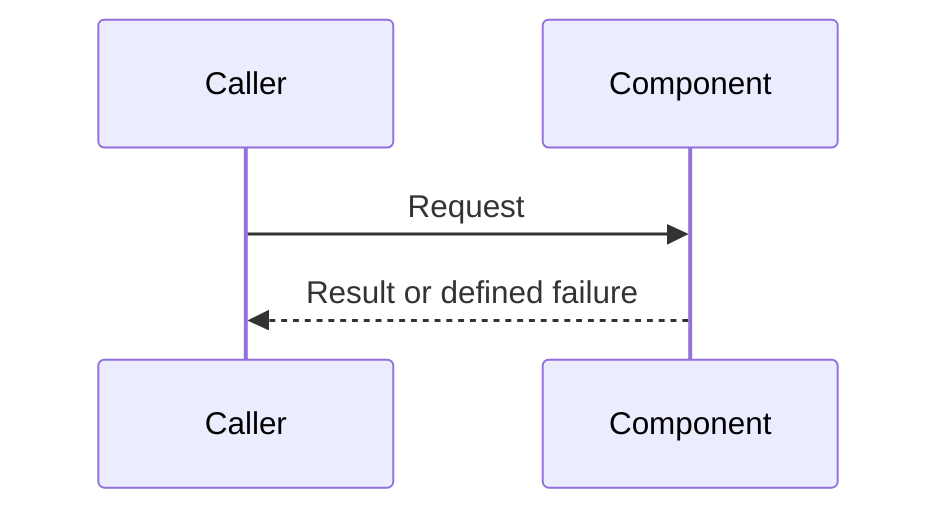

# Low-Level Design

> Template for `docs/lld.md` in a consuming project. Translate approved SAD requirements into implementation-ready contracts without changing product intent.

**Owner:** Software Architect  
**Status:** Draft  
**Last updated:** YYYY-MM-DD  
**Input:** `docs/sad.md`

## 1. Design Scope

List the requirement IDs and architectural elements covered by this design. State explicit exclusions.

## 2. Current, Target, and Migration State

### Current State

Describe behavior and structures verified in the workspace.

### Target State

Describe the approved implementation design.

### Migration State

Document temporary compatibility, rollout, or migration behavior. Use `Not applicable` when none is required.

## 3. Module and Dependency Boundaries

| Module or component | Responsibility | Allowed dependencies | Prohibited dependencies | Lifecycle/entry point |
|---|---|---|---|---|
| `<module>` | `<responsibility>` | `<dependencies>` | `<prohibitions>` | `<entry and lifecycle>` |

Include a dependency diagram when it improves clarity.

## 4. Data Contracts

| Contract | Fields/types | Invariants and validation | Ownership | Persistence/sensitivity | Requirements |
|---|---|---|---|---|---|
| `<contract>` | `<fields>` | `<rules>` | `<owner>` | `<storage and classification>` | `<IDs>` |

Document serialization, versioning, defaults, optionality, and compatibility where relevant.

## 5. Interfaces

| Interface | Inputs | Outputs | Preconditions | Postconditions | Failure contract | Compatibility |
|---|---|---|---|---|---|---|
| `<interface>` | `<inputs>` | `<outputs>` | `<conditions>` | `<guarantees>` | `<errors>` | `<expectations>` |

Specify idempotency, timeout, retry, and cancellation behavior where applicable.

## 6. Program Flow and State

Describe success paths, alternate paths, state transitions, concurrency, partial failures, and resource cleanup.

## 7. Failure Semantics

| Failure category | Detection | Propagation | Recovery | User-visible behavior | Observability |
|---|---|---|---|---|---|
| `<failure>` | `<signal>` | `<contract>` | `<recovery>` | `<behavior>` | `<log, metric, or trace>` |

## 8. Security and Privacy

Document authorization points, trust boundaries, input validation, secret handling, sensitive-data controls, audit behavior, and security requirements inherited from the SAD.

## 9. Configuration and Dependencies

### Configuration

| Setting | Source | Required/default | Validation | Sensitive | Requirements |
|---|---|---|---|---|---|
| `<setting>` | `<source>` | `<rule>` | `<validation>` | `<yes/no>` | `<IDs>` |

### Dependencies

| Dependency | Purpose | Version policy | Rationale | Existing alternative considered |
|---|---|---|---|---|
| `<dependency>` | `<purpose>` | `<policy>` | `<rationale>` | `<alternative>` |

Do not introduce a dependency without checking existing project capabilities and documenting requirement-based rationale.

## 10. Observability and Operations

| Signal | Purpose | Content/metric | Correlation | Sensitive-data rule | Related NFR |
|---|---|---|---|---|---|
| `<log, metric, trace, or health signal>` | `<purpose>` | `<definition>` | `<correlation>` | `<redaction rule>` | `<ID>` |

## 11. Migration, Compatibility, and Rollback

Describe data migration, public-contract compatibility, rollout sequencing, fallback, rollback, and cleanup. Use `Not applicable` with rationale when none is needed.

## 12. Verification Design

| Requirement | Test level or inspection | Test seam/fixture | Success evidence | Failure/boundary coverage |
|---|---|---|---|---|
| `FR-001` | `<unit, integration, contract, end-to-end, inspection>` | `<seam>` | `<evidence>` | `<cases>` |

Document the project-specific locations and commands for test assets and quality gates.

## 13. Traceability Matrix

| Requirement | Design element | Interface/data/flow | Planned verification |
|---|---|---|---|
| `FR-001` | `<DES ID or section>` | `<contract>` | `<verification>` |

## 14. Implementation Decisions

| ID | Decision | Requirements | Alternatives | Rationale | Consequences | Supersedes |
|---|---|---|---|---|---|---|
| `DES-001` | `<decision>` | `<IDs>` | `<alternatives>` | `<rationale>` | `<consequences>` | `<DES ID or none>` |

Preserve decision IDs across revisions and mark superseded decisions instead of deleting their history.

## 15. Project Conventions

Document naming, file placement, error handling, dependency management, generated artifacts, formatting, and other implementation conventions needed by downstream agents.

## 16. Open Design Issues and Drift

| Issue | Type | Impact | Owner | Resolution needed |
|---|---|---|---|---|
| `<issue>` | `<ambiguity, conflict, untestable requirement, or code/spec drift>` | `<impact>` | `<owner>` | `<decision>` |
