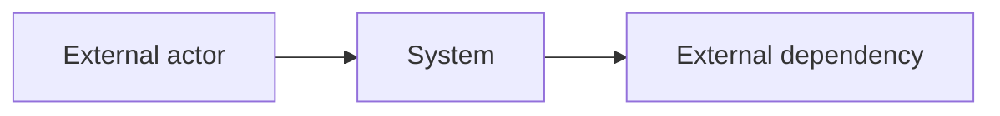

# Solution Architecture Document

> Template for `docs/sad.md` in a consuming project. Replace placeholder text with verified project information. Preserve existing requirement identifiers when adopting an established project.

**Owner:** Solution Architect  
**Status:** Draft  
**Last updated:** YYYY-MM-DD

## 1. Context and Problem

Describe the verified current state, the problem to solve, affected stakeholders, and why the change matters.

## 2. Stakeholders and Outcomes

| Stakeholder | Need | Desired outcome | Evidence/source |
|---|---|---|---|
| `<stakeholder>` | `<need>` | `<observable outcome>` | `<source>` |

## 3. Scope

### Goals

- `<in-scope outcome>`

### Non-Goals

- `<explicitly excluded outcome>`

### System Boundary

Describe what is inside and outside the system boundary, including external actors.

## 4. Requirements

### Functional Requirements

| ID | Requirement | Priority | Verification method | Status |
|---|---|---|---|---|
| `FR-001` | `<observable behavior>` | `<priority>` | `<test, inspection, metric, or demonstration>` | Proposed |

### Quality Attributes

| ID | Attribute | Metric | Threshold | Operating condition | Verification method |
|---|---|---|---|---|---|
| `NFR-001` | `<attribute>` | `<metric>` | `<threshold>` | `<condition>` | `<method>` |

### Constraints

| ID | Constraint | Source | Consequence |
|---|---|---|---|
| `CON-001` | `<business, regulatory, operational, or technical constraint>` | `<source>` | `<design impact>` |

## 5. Assumptions and Open Questions

### Assumptions

| Assumption | Evidence | Consequence if false |
|---|---|---|
| `<assumption>` | `<supporting evidence>` | `<impact>` |

### Open Questions

| Question | Owner | Decision needed by | Impact |
|---|---|---|---|
| `<question>` | `<owner>` | `<date or milestone>` | `<impact>` |

## 6. Solution Architecture

### System Context

Describe actors, external systems, trust boundaries, and the system's responsibilities.

### Components

| Component | Responsibility | Satisfies | Dependencies |
|---|---|---|---|
| `<component>` | `<single clear responsibility>` | `<requirement IDs>` | `<components or external systems>` |

### Key Interactions and Data Flows

Describe important success paths, alternate paths, failure scenarios, and conceptual data movement.

## 7. Integrations

| Integration | Purpose | Conceptual contract | Failure behavior | Owner |
|---|---|---|---|---|
| `<external dependency>` | `<purpose>` | `<inputs and outputs>` | `<expected handling>` | `<owner>` |

## 8. Security, Privacy, and Trust

Document trust boundaries, data classification, authorization expectations, sensitive-data handling, audit needs, and material threats derived from requirements.

## 9. Architectural Decisions and Trade-Offs

| Decision | Options considered | Choice and rationale | Consequences | Reversibility |
|---|---|---|---|---|
| `<decision>` | `<options>` | `<choice and why>` | `<positive and negative consequences>` | `<easy, moderate, difficult>` |

## 10. Requirement Traceability

| Requirement | Architectural element | Interaction or decision | Verification method |
|---|---|---|---|
| `FR-001` | `<component>` | `<flow or decision>` | `<method>` |

## 11. Risks

| Risk | Likelihood | Impact | Mitigation | Owner |
|---|---|---|---|---|
| `<risk>` | `<level>` | `<level>` | `<mitigation>` | `<owner>` |

## 12. Deferred and Deprecated Requirements

Keep removed or deferred requirement IDs stable. Record status, rationale, and downstream impact instead of deleting them silently.
